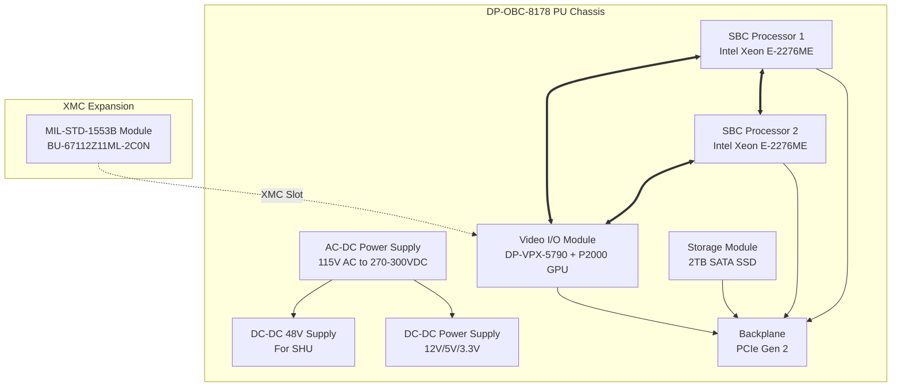
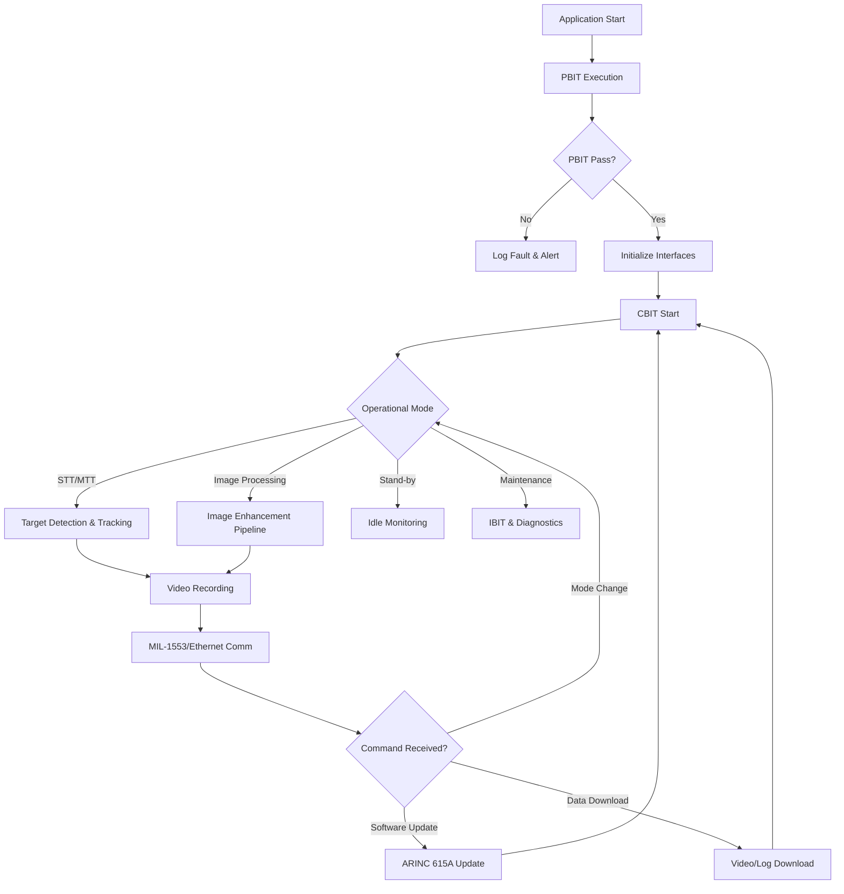
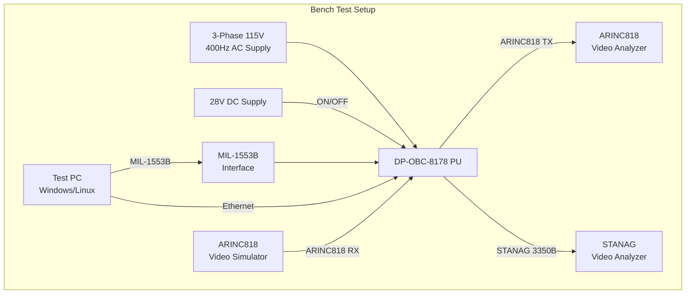

## DOCUMENT CONTROL

| Document Information | Details                                   |
| -------------------- | ----------------------------------------- |
| Document Title       | Software Requirements Specification (SRS) |
| Document Reference   | DP-OBC-8178-660-SRS                       |
| Version Number       | 0V01                                      |
| Version Date         | 2026-04-30                                |
| Prepared By          | Data Patterns (India) Ltd.                |
| Document Review By   | [REVIEWER]                                |
| Technical Review By  | [TECHNICAL_REVIEWER]                      |
| Process Review By    | [PROCESS_REVIEWER]                        |
| Approved By          | [APPROVER]                                |

---

## REVISION HISTORY

| Version | Date       | Author        | Description of Changes |
| ------- | ---------- | ------------- | ---------------------- |
| 0V01    | 2026-04-30 | Data Patterns | Initial Version        |
|         |            |               |                        |
|         |            |               |                        |

---

## 1. INTRODUCTION

### 1.1 Purpose

This Software Requirements Specification (SRS) document describes the requirements involved in the design and development of the test application software for DP-OBC-8178 Ruggedized Processor Unit (PU) for Infrared Search and Track (IRST) system. The software shall be used to test and qualify the hardware components including dual SBC processors, video I/O module with GPGPU, MIL-STD-1553B interface, storage module, and all communication interfaces. The test application shall support both bench-level testing and environmental qualification testing for airborne certification.

**Table 1.1: Entities Involved in DP-OBC-8178**

| Topics                | Details                                  |
| --------------------- | ---------------------------------------- |
| Identification Number | DP-OBC-8178                              |
| Title                 | Ruggedized Processor Unit for IRST (PU)  |
| Version Number        | 0V01                                     |
| Abbrevation           | SRS (Software Requirement Specification) |

---

### 1.2 Scope

Scope of this document is to capture the functional, operation, interface, performance, safety, and qualification related requirements for the test application software. The software shall be developed for system-specific requirements and for testing the functionality of DP-OBC-8178 Ruggedized Processor Unit for IRST.

The PU is an airborne qualified hardware system comprising dual 9th Generation Intel Xeon E-2276ME processors (6 core, 2.8GHz, 12-thread), 32GB DDR4 SDRAM, NVIDIA Quadro P2000 GPGPU (768 CUDA cores, 2.3 TFLOPS), 2TB SATA SSD storage, and comprehensive I/O interfaces including dual ARINC818 fiber optic video input/output, dual STANAG 3350B video output, MIL-STD-1553B dual redundant bus, RS422 interfaces, and Ethernet links.

The test application shall validate all hardware modules including the AC-DC and DC-DC power supply modules, dual SBC processor redundancy, video processing pipeline, MIL-STD-1553B BC/RT/MT functionality, Built-In Test (PBIT/CBIT/IBIT) operations, and data recording capabilities. The software shall operate on RT Linux (RHEL 7.7) and support both manual and automated test execution modes for design validation, production testing, and environmental stress screening.

The application shall support bench-level testing with PC-based GUI for command simulation, navigation data injection, real-time monitoring, and logged data download. It shall also support software update functionality as per ARINC 615A standard through Ethernet interface.

---

### 1.3 Definitions, Acronyms, and Abbreviations

**Table 1.2: List of Definitions, Acronyms, and Abbreviations**

| Term/Acronym | Definition                                                          |
| ------------ | ------------------------------------------------------------------- |
| SRS          | Software Requirements Specification                                 |
| SDD          | Software Design Document                                            |
| HRS          | Hardware Requirements Specification                                 |
| SyRS         | System Requirements Specification                                   |
| PU           | Processing Unit                                                     |
| IRST         | Infrared Search and Track                                           |
| SHU          | Sensor Head Unit                                                    |
| SBC          | Single Board Computer                                               |
| GPGPU        | General Purpose Graphics Processing Unit                            |
| ARINC818     | Aeronautical Radio Incorporated 818 (Fiber Optic Video)             |
| STANAG       | Standardization Agreement 3350B                                     |
| MIL-STD      | Military Standard                                                   |
| BC           | Bus Controller                                                      |
| RT           | Remote Terminal                                                     |
| MT           | MoniTor                                                             |
| PBIT         | Power-Up Built-In Test                                              |
| CBIT         | Continuous Built-In Test                                            |
| IBIT         | Initiated Built-In Test                                             |
| BIT          | Built-In Test                                                       |
| AC-DC        | Alternating Current to Direct Current Converter                     |
| DC-DC        | Direct Current to Direct Current Converter                          |
| DDR4         | Double Data Rate 4 SDRAM                                            |
| SSD          | Solid State Drive                                                   |
| SATA         | Serial Advanced Technology Attachment                               |
| PCIe         | Peripheral Component Interconnect Express                           |
| XMC          | Express Mezzanine Card                                              |
| VPX          | Virtual Path Cross-Connect                                          |
| FPGA         | Field Programmable Gate Array                                       |
| CUDA         | Compute Unified Device Architecture                                 |
| OpenCL       | Open Computing Language                                             |
| RHEL         | Red Hat Enterprise Linux                                            |
| RTOS         | Real-Time Operating System                                          |
| GUI          | Graphical User Interface                                            |
| API          | Application Programming Interface                                   |
| BSP          | Board Support Package                                               |
| COTS         | Commercial Off-The-Shelf                                            |
| MRAM         | Magnetoresistive Random Access Memory                               |
| LVDS         | Low-Voltage Differential Signaling                                  |
| JTAG         | Joint Test Action Group                                             |
| EMI          | Electromagnetic Interference                                        |
| EMC          | Electromagnetic Compatibility                                       |
| ESS          | Environmental Stress Screening                                      |
| SOFT         | Safety of Flight Test                                               |
| CATH         | Combined Altitude, Temperature and Humidity                         |
| DO-178B      | Design Assurance Level C Software Standard                          |
| DO-160G      | Environmental Conditions and Test Procedures for Airborne Equipment |
| IP           | Ingress Protection                                                  |
| ATR          | Airborne Transceiver Receiver (19-inch rack standard)               |
| SGRP         | Single Ground Reference Point                                       |
| LVDS         | Low-Voltage Differential Signaling                                  |
| OFP          | Operational Flight Program                                          |
| SVP          | Sensor Video Processor                                              |
| MMDC         | Mission Management and Display Computer                             |

---

### 1.4 References

**Table 1.3: Reference Documents**

| S.NO | Document                                                                                | Reference                                                           | Date       |
| ---- | --------------------------------------------------------------------------------------- | ------------------------------------------------------------------- | ---------- |
| 1    | Hardware Requirements Specification                                                     | DP-OBC-8178-660-HRS-0V06                                            | 2022-09-02 |
| 2    | System Requirements Specification                                                       | DP-OBC-8178-660-SyRS-0V06                                           | 2022-09-02 |
| 3    | Technical Specifications Document for Development of Ruggedized Processor Unit for IRST | Annexure B                                                          | -          |
| 4    | Contract Document "Development of Rugged Processing Unit for IRST"                      | 12901IR2122R344X030                                                 | 2022-05-19 |
| 5    | Software Requirement Data (SRD)                                                         | DP-OBC-8178-660-SRD                                                 | -          |
| 6    | MIL-STD-704D                                                                            | Aircraft Electric Power Characteristics                             | -          |
| 7    | MIL-STD-461G                                                                            | EMC Requirements for Electronic Equipment                           | -          |
| 8    | MIL-STD-810H                                                                            | Environmental Engineering Considerations                            | -          |
| 9    | RTCA/DO-160G                                                                            | Environmental Conditions and Test Procedures for Airborne Equipment | -          |
| 10   | ARINC 615A                                                                              | Data Load Protocol                                                  | -          |

---

### 1.5 Document Overview

**Document Organization:**

This Software Requirements Specification (SRS) document is organized as follows:

- **Section 1 (Introduction):** Provides an overview of the document, including its purpose, scope, definitions, and references.

- **Section 2 (Overall Description):** Describes the product perspective, functions, user classes, operating environment, design constraints, and assumptions.

- **Section 3 (External Interface Requirements):** Details the user, hardware, software, and communications interfaces.

- **Section 4 (Functional Requirements):** Specifies the functional requirements organized by application/module type.

- **Section 5 (Software System Attributes):** Covers performance, safety, security requirements, and software quality attributes.

- **Section 6 (Other Requirements):** Addresses any additional requirements not covered elsewhere.

- **Section 7 (Requirements Traceability):** Maps requirements from customer documents to this SRS.

- **Appendices:** Contains KC mapping and supporting information.

---

## 2. OVERALL DESCRIPTION

### 2.1 Product Perspective

The Ruggedized Processor Unit (PU) for Infrared Search and Track (IRST) is an airborne surveillance system that performs automatic target detection and tracks multiple targets simultaneously. The PU receives video input from the Sensor Head Unit (SHU) through dual ARINC818 fiber optic interfaces and processes the data using dual SBC processors and GPGPU acceleration. The system generates processed video compatible with airborne standards (ARINC818, STANAG 3350B) and communicates with the Host Computer (MMDC) through MIL-STD-1553B and Ethernet interfaces.

The test application software developed for the PU shall provide comprehensive hardware validation and testing capabilities for all integrated modules. The system architecture comprises multiple interconnected modules housed in a 1/2 ATR chassis with forced air cooling.

**Key Modules:**

**AC-DC Power Supply Module:** Converts the input 3-phase, 115V, 400Hz AC supply to 270-300VDC for internal distribution. The module provides surge protection and EMI/EMC filtering compliant with MIL-STD-461G and MIL-STD-704D standards.

**DC-DC Power Supply Module (12V/5V/3.3V):** Converts the 270-300VDC to regulated +12V, +5V, and +3.3V supplies required by the COTS modules (SBCs, Video I/O, Storage). The module includes Built-In Test support for health monitoring.

**DC-DC Converter Module (48V Output):** Converts the 270-300VDC to 48VDC supply for the external Sensor Head Unit (SHU), capable of delivering 400W maximum power.

**Dual SBC Processor Module (DP-VPX-0750):** Two 3U VPX Single Board Computers with Intel Xeon E-2276ME processors (6 core, 2.8GHz, 12-thread), 32GB DDR4 SDRAM with ECC, 64GB SATA NAND flash, and extensive I/O including RS422, RS232, and Gigabit Ethernet. The SBCs operate in redundant configuration for high availability.

**Video I/O and Image Processing Module (DP-VPX-5790):** A 3U VPX module with Xilinx FPGA and NVIDIA Quadro P2000 GPGPU (768 CUDA cores, 4GB GDDR5, 2.3 TFLOPS). The module provides dual ARINC818 fiber optic video input (640x512, 50fps, 13-bit monochrome), dual ARINC818 output (1280x1024, 50fps, 24-bit RGB), and dual STANAG 3350B output (640x512, 50fps, 8-bit monochrome).

**Storage Module (DP-VPX-4001):** A 3U VPX module with 2.5-inch SATA SSD providing 2TB storage capacity for continuous raw video recording (up to 10 hours at 0.3Gbps data rate).

**MIL-STD-1553B XMC Module:** A conduction-cooled XMC module providing dual redundant MIL-STD-1553B interface with BC/RT/MT functionality for communication with the Mission Management and Display Computer (MMDC).

**Field Interface Module:** A custom chassis-mounted module with MIL-D38999 Series III connectors for external interfaces including AC power input, SHU interface, MMDC interface, and maintenance connector.

**Backplane Module:** A 3U VPX backplane with PCIe Gen 2 connectivity between SBCs, Video I/O board, and Storage module, plus routing of all I/O signals to chassis connectors.

**Figure 2.1: DP-OBC-8178 PU System Architecture Block Diagram**

---

### 2.2 Product Functions

The Ruggedized Processor Unit test application provides comprehensive hardware validation, embedded software testing, and GUI-based bench-level testing capabilities for the DP-OBC-8178 system.

**System Initialization and Health Monitoring:** The application shall perform complete system initialization including hardware detection, resource allocation, and interface configuration. During power-up, the PBIT (Power-Up Built-In Test) shall be executed automatically to verify all hardware modules. Continuous health monitoring (CBIT) shall run in all operational modes to detect and log faults.

**Video Processing Validation:** The test application shall validate the complete video processing pipeline including ARINC818 video input acquisition from SHU, real-time target detection and tracking algorithms running on GPGPU, coordinate transformation, track management, and video output generation in ARINC818 and STANAG 3350B formats.

**Communication Interface Testing:** All communication interfaces shall be tested including dual ARINC818 fiber optic video links, MIL-STD-1553B dual redundant bus (BC/RT/MT modes), RS422 discrete I/O, and Ethernet interfaces. The testing shall verify protocol compliance, data integrity, and performance characteristics.

**Storage and Recording Validation:** The storage module testing shall validate continuous raw video recording capability (up to 10 hours at 0.3Gbps), video download through Ethernet interface, and data integrity verification.

**Operational Mode Testing:** The application shall support testing of all operational modes including Single Target Tracking (STT), Multi-Target Tracking (MTT), Image Processing, Stand-by, and Maintenance Mode. Mode selection and transition shall be validated through MIL-STD-1553B commands.

**Built-In Test (BIT) Execution:** The application shall support PBIT (power-up), CBIT (continuous), and IBIT (on-demand) execution with status logging and retrieval from MRAM storage.

**Environmental Testing Support:** The application shall support Safety of Flight Test (SOFT) and Environmental Stress Screening (ESS) procedures as per MIL-STD-2164 and DO-160G requirements.

**Software Update:** The application shall support software/firmware updates through Ethernet interface as per ARINC 615A standard.

**Figure 2.2: DP-OBC-8178 PU Operational Flow Diagram**

**Key Functionalities:**

1. **Automatic Target Detection:** Real-time detection of infrared targets with clutter rejection algorithms running on GPGPU.

2. **Multi-Target Tracking:** Simultaneous tracking of multiple targets with track management and track list generation.

3. **Kinematic Ranging:** Target range estimation using kinematic data from tracking algorithms.

4. **Coordinate Transformation:** Conversion of sensor coordinates to mission-relevant coordinate systems.

5. **Video Recording:** Continuous raw video storage at 0.3Gbps data rate for up to 10 hours.

6. **Command and Control:** Real-time command execution from MMDC via MIL-STD-1553B and RS422 interfaces.

7. **Status Reporting:** Continuous status and track list transmission to MMDC via MIL-STD-1553B and Ethernet.

---

### 2.3 User Classes and Characteristics

The different users of the DP-OBC-8178 test application are:

- **Design Engineers (IRDE/Developer):** Require comprehensive testing and diagnostic capabilities for design validation, algorithm verification, and system integration. They possess in-depth knowledge of the system architecture, IRST algorithms, and airborne standards. They need access to all test functions, debug interfaces, and detailed measurement data.

- **Production Test Operators:** Need straightforward test execution capabilities for production line testing and Environmental Stress Screening (ESS). They require basic product knowledge and clear pass/fail indicators with minimal technical detail. Access limited to predefined test sequences.

- **Maintenance Technicians:** Require diagnostic capabilities for field troubleshooting and IBIT execution. They need moderate system knowledge and access to module-level testing, log retrieval, and software update functions.

- **Quality Assurance/Certification Personnel:** Require detailed test reports and compliance verification for SOFT testing and CEMILAC certification. They need access to historical data, trend analysis, and certification documentation.

- **Ground Support Engineers:** Operate the PC-based GUI application for bench-level testing, command simulation, and data analysis. They require training on GUI functionality and data interpretation.

All users shall have access to role-specific functionality with appropriate security controls. The application shall support user authentication and authorization to ensure proper access control.

---

### 2.4 Operating Environment

The operating environment details of the software are given in the below table.

**Table 2.1: Operating Environment Specifications**

| Environment Category     | Specification                                                                                                                                                                                                             |
| ------------------------ | ------------------------------------------------------------------------------------------------------------------------------------------------------------------------------------------------------------------------- |
| **Hardware Platform**    | Dual Intel Xeon E-2276ME (6 core, 2.8GHz, 12-thread), 32GB DDR4 ECC RAM per SBC, NVIDIA Quadro P2000 GPGPU (768 CUDA cores, 4GB GDDR5), 2TB SATA SSD, 3U VPX modules in 1/2 ATR chassis, MIL-D38999 Series III connectors |
| **Operating System**     | RT Linux (RHEL 7.7 or higher) on SBCs, Windows/Linux for PC-based GUI                                                                                                                                                     |
| **Software Environment** | Board Support Package (BSP) for RT Linux, CUDA Toolkit 10.x or higher for GPU, OpenCL support, MIL-STD-1553B device drivers, ARINC 615A protocol stack, Qt framework for GUI                                              |
| **Network Environment**  | Dual ARINC818 fiber optic (850nm multi-mode, 640x512@50fps input, 1280x1024@50fps output), MIL-STD-1553B dual redundant bus (1Mbps), RS422 (115200 bps), Ethernet (1Gbps + 100Mbps), STANAG 3350B video output            |

---

### 2.5 Design and Implementation Constraints

- The embedded application shall run exclusively on RT Linux (RHEL 7.7 or higher) operating system.
- All hardware interface drivers shall be provided through the Board Support Package (BSP) from module vendors.
- The video processing algorithms shall utilize CUDA and OpenCL for GPGPU acceleration.
- Real-time performance requirements shall be met for target detection and tracking (50fps video processing).
- All communication protocols shall comply with military and airborne standards (MIL-STD-1553B, ARINC818, STANAG 3350B).
- The application shall support DO-178B Level C certification requirements.
- GUI shall be developed using cross-platform framework for bench-level testing.
- All test results and BIT status shall be stored in MRAM for retrieval during maintenance.
- The application shall support ARINC 615A standard for software updates.
- Software shall be developed in C/C++ using MISRA C 2012 standard.
- Dual SBC redundancy shall be implemented with automatic failover capability.

---

### 2.6 User Documentation

The product shall include the following documents:

- **User Manual:** Comprehensive guide for PU operation, test execution, and maintenance procedures.
- **Quick Start Guide:** Basic operation instructions for production testing and bench-level testing.
- **Software Requirement Data (SRD):** Technical documentation for embedded software architecture and APIs.
- **Test Procedure Documents:** SOP for SOFT testing, ESS testing, and Acceptance Testing.
- **Troubleshooting Guide:** Diagnostic procedures, fault codes, and error resolution.
- **Release Notes:** Version-specific information, known issues, and upgrade procedures.
- **Maintenance Manual:** IBIT procedures, log retrieval, and software update instructions.

---

### 2.7 Assumptions and Dependencies

**Assumptions:**

- Assumption 1: All hardware modules are properly installed, powered, and within operating temperature range - if incorrect, test execution will fail with hardware detection or BIT failures.
- Assumption 2: RT Linux BSP is correctly installed with all device drivers for COTS modules - if incorrect, hardware interfaces may not function properly.
- Assumption 3: Sensor Head Unit (SHU) is available and functional for video input testing - if incorrect, video processing validation cannot be completed.
- Assumption 4: Host Computer (MMDC) or simulator is available for MIL-STD-1553B communication testing - if incorrect, full system integration testing cannot be performed.
- Assumption 5: IRDE-provided target detection and tracking algorithms are available for integration - if incorrect, core functionality testing is limited.

**Dependencies:**

- Dependency 1: Board Support Package (BSP) from COTS module vendors (SBC, Video I/O, Storage) - changes may require application recompilation and revalidation.
- Dependency 2: CUDA Toolkit and GPU driver version compatibility - updates may affect algorithm performance and require optimization.
- Dependency 3: MIL-STD-1553B XMC module driver and firmware - changes may affect bus communication functionality.
- Dependency 4: ARINC 615A IP core for software update functionality - integration dependencies for load transfer protocol.
- Dependency 5: Customer (IRDE) provided algorithms for target detection and tracking - algorithm performance affects system-level requirements.

---

## 3. EXTERNAL INTERFACE REQUIREMENTS

External interface requirements define the connections between the software product and its external environment, including users, hardware, software, and communications interfaces.

### 3.1 User Interfaces

The application software shall interface with users through two modes:

**Embedded GUI (Maintenance Mode):** The PU provides a local display output (via STANAG 3350B or ARINC818) for maintenance personnel to view BIT status, system health, and diagnostic information during IBIT execution.

**PC-Based GUI Application:** A Windows/Linux based GUI application for bench-level testing shall be developed with the following features:

- Application shall consist of standard GUI layouts such as menu bar, action log, standard buttons, and user-friendly controls.
- All controls shall be available with keyboard shortcuts and shall be tab ordered.
- Pop-up message boxes shall be used to provide warning and error messages to intimate the user about failures or serious events.
- Every user action shall be listed in the action log to monitor previous activities.
- Navigation panel shall be used to assist the user for easy transition in accessing each functionality.
- Test results shall be displayed in tabular format with color-coded pass/fail indicators.
- Real-time status indicators shall show system health, video status, and communication link status.
- Command simulation panel shall allow injection of navigation data and operational mode commands.
- Data logging and visualization panels for real-time monitoring of PU parameters.

---

### 3.2 Hardware Interfaces

**Table 3.1: Hardware Interfaces**

| Sl.No. | Device                        | Interface                         | Description                                                            |
| ------ | ----------------------------- | --------------------------------- | ---------------------------------------------------------------------- |
| 1      | SBC Processor Module 1        | 3U VPX Backplane, PCIe Gen 2      | Primary processor with Intel Xeon E-2276ME, 32GB DDR4, 64GB SATA flash |
| 2      | SBC Processor Module 2        | 3U VPX Backplane, PCIe Gen 2      | Redundant processor with identical configuration                       |
| 3      | Video I/O Module              | 3U VPX Backplane, PCIe Gen 2, MXM | Video acquisition/processing with FPGA + NVIDIA P2000 GPGPU            |
| 4      | Storage Module                | 3U VPX Backplane, SATA 3.0        | 2TB SATA SSD for raw video recording                                   |
| 5      | MIL-STD-1553B Module          | XMC slot, PCIe x1                 | Dual redundant 1553B interface (BC/RT/MT)                              |
| 6      | AC-DC Power Supply            | 3U VPX Power Backplane            | Converts 115V AC 400Hz to 270-300VDC                                   |
| 7      | DC-DC Power Supply (Internal) | 3U VPX Power Backplane            | Converts 270-300VDC to 12V/5V/3.3V                                     |
| 8      | DC-DC Power Supply (48V SHU)  | 3U VPX Power Backplane            | Converts 270-300VDC to 48VDC for SHU                                   |
| 9      | Backplane Module              | 3U VPX Backplane                  | PCIe Gen 2 routing, I/O signal distribution                            |
| 10     | AC Power Input Connector      | D38999/24WD15SN (Panel Mount)     | 3-phase 115V AC input + 28V ON/OFF control                             |
| 11     | MMDC Interface Connector      | TV07RW-15-35S-S15 (Board Mount)   | MIL-1553B, STANAG 3350B, Ethernet, Discrete                            |
| 12     | SHU Interface Connector       | TV07RW-23-55S-S15 (Board Mount)   | SHU power, RS422, Ethernet, LVDS                                       |
| 13     | ARINC818 Video TX             | FS801-11P02ACA (Panel Mount)      | Dual fiber optic video output to SVP                                   |
| 14     | ARINC818 Video RX             | FS801-11P02ACA (Panel Mount)      | Dual fiber optic video input from SHU                                  |
| 15     | Maintenance Connector         | TV07RW-15-35SA-S15 (Board Mount)  | RS232, Ethernet, JTAG for debugging                                    |

---

### 3.3 Software Interfaces

The application shall interface with the following software components:

- **Board Support Package (BSP):** Provides hardware abstraction layer for all COTS device drivers (SBC, Video I/O, Storage, 1553B).
- **RT Linux Kernel:** Version 4.x or later for RHEL 7.7 compatibility with real-time patches.
- **CUDA Runtime:** Version 10.x or later for GPU-accelerated video processing and target detection algorithms.
- **OpenCL Runtime:** For cross-platform GPU computing support.
- **MIL-STD-1553B Driver:** Device driver for BU-67112Z11ML-2C0N XMC module with BC/RT/MT functionality.
- **ARINC 615A Protocol Stack:** For software update and data load functionality through Ethernet.
- **Qt Framework:** Version 5.x or later for PC-based GUI application development.
- **Database System:** SQLite or equivalent for test result storage and BIT log management.
- **Communication Libraries:** libserial for RS422/RS232, socket libraries for Ethernet, custom drivers for ARINC818.

---

### 3.4 Communications Interfaces

**Table 3.2: Communications Interfaces**

| Sl.No. | Interface             | Protocol/Standard            | Description                                                         |
| ------ | --------------------- | ---------------------------- | ------------------------------------------------------------------- |
| 1      | ARINC818 Video Input  | ARINC 818 (Fiber Optic)      | Dual channel video from SHU (640x512@50fps, 13-bit monochrome)      |
| 2      | ARINC818 Video Output | ARINC 818 (Fiber Optic)      | Dual channel video to SVP (1280x1024@50fps, 24-bit RGB)             |
| 3      | MIL-STD-1553B         | MIL-STD-1553B Dual Redundant | Communication with MMDC (BC mode for commands, RT mode for status)  |
| 4      | RS422 Discrete I/O    | RS422 Serial (115200 bps)    | Command/control to SHU, tracking error feedback, discrete I/O       |
| 5      | Ethernet (High Speed) | 1Gbps TCP/IP                 | Software update (ARINC 615A), video download, MMDC communication    |
| 6      | Ethernet (Low Speed)  | 100Mbps TCP/IP               | SHU communication, MMDC communication, maintenance                  |
| 7      | STANAG 3350B          | STANAG 3350 Class B          | Dual channel video output to MMDC (640x512@50fps, 8-bit monochrome) |
| 8      | RS232 Debug           | RS232 Serial                 | Maintenance connector for local debugging                           |
| 9      | JTAG                  | IEEE 1149.1                  | Maintenance connector for processor debugging                       |

---

## 4. FUNCTIONAL REQUIREMENTS

**Table 4.1: DP-OBC-8178 PU Validation Test Requirement IDs**

| Sl.No. | Requirement ID       | Requirement Name             | Reference Requirement ID |
| ------ | -------------------- | ---------------------------- | ------------------------ |
| 1      | DP_OBC_8178_HOST_01  | PC-Based GUI Application     | PU-SyRS-GUI-001          |
| 2      | DP_OBC_8178_EMBED_02 | Embedded Application         | PU-SyRS-SWR-001          |
| 3      | DP_OBC_8178_SBC_03   | SBC Processor Module Test    | PU-SyRS-SBCP-MOD-001     |
| 4      | DP_OBC_8178_VIO_04   | Video I/O Module Test        | PU-SyRS-VIO-MOD-001      |
| 5      | DP_OBC_8178_STRG_05  | Storage Module Test          | PU-SyRS-STRG-MOD-001     |
| 6      | DP_OBC_8178_PWR_06   | Power Supply Test            | PU-SyRS-PWR-001          |
| 7      | DP_OBC_8178_1553_07  | MIL-STD-1553B Module Test    | PU-SyRS-1553B-MOD-001    |
| 8      | DP_OBC_8178_INT_08   | Communication Interface Test | PU-SyRS-EXT-001          |
| 9      | DP_OBC_8178_BIT_09   | Built-In Test Execution      | PU-SyRS-FNC-007          |
| 10     | DP_OBC_8178_MODE_10  | Operational Mode Testing     | PU-SyRS-FNC-008          |

---

### 4.1 Host Application (PC-Based GUI)

**Description:**
The host application is a PC-based GUI application that runs on Windows/Linux for bench-level testing of the DP-OBC-8178 PU. It communicates with the PU through MIL-STD-1553B and Ethernet interfaces to provide command simulation, navigation data injection, real-time monitoring, and data download capabilities.

**Table 4.2: Host Application Test Requirement**

| Sl.No | Requirement ID      | Requirement Name         |
| ----- | ------------------- | ------------------------ |
| 1     | DP_OBC_8178_HOST_01 | PC-Based GUI Application |

**Table 4.3: Host Application Test Sub Requirements**

| Sl.No | Sub Requirement ID              | Requirement Name          |
| ----- | ------------------------------- | ------------------------- |
| 1     | DP_OBC_8178_HOST_CONN_01_01     | Connection Management     |
| 2     | DP_OBC_8178_HOST_CMD_SIM_01_02  | Command Simulation        |
| 3     | DP_OBC_8178_HOST_NAV_DATA_01_03 | Navigation Data Injection |
| 4     | DP_OBC_8178_HOST_MONITOR_01_04  | Real-Time Monitoring      |
| 5     | DP_OBC_8178_HOST_LOG_01_05      | Data Logging              |
| 6     | DP_OBC_8178_HOST_VIDEO_01_06    | Video Download            |
| 7     | DP_OBC_8178_HOST_STATUS_01_07   | Status Display            |
| 8     | DP_OBC_8178_HOST_UPDATE_01_08   | Software Update Interface |

---

#### 4.1.1 Connection Management

**Description:**
The connection management module shall establish and maintain communication with the PU through MIL-STD-1553B and Ethernet interfaces. It shall detect connection status and provide reconnection capabilities.

**Table 4.4: Connection Management**

| Requirement ID              | Requirement Description                                                                                                                                                                                        |
| --------------------------- | -------------------------------------------------------------------------------------------------------------------------------------------------------------------------------------------------------------- |
| DP_OBC_8178_HOST_CONN_01_01 | **Description:** The GUI shall establish MIL-STD-1553B communication as Bus Controller and Ethernet connection for data transfer. Connection status shall be displayed with automatic reconnection on failure. |

---

#### 4.1.2 Command Simulation

**Description:**
The command simulation module shall generate and transmit commands to the PU as per MIL-STD-1553B protocol. Commands include mode selection, IBIT initiation, and status requests.

**Table 4.5: Command Simulation**

| Requirement ID                 | Requirement Description                                                                                                                                                                                                  |
| ------------------------------ | ------------------------------------------------------------------------------------------------------------------------------------------------------------------------------------------------------------------------ |
| DP_OBC_8178_HOST_CMD_SIM_01_02 | **Description:** The GUI shall simulate commands for operational mode selection (STT, MTT, Image Processing, Stand-by, Maintenance), IBIT initiation, and parameter configuration as per customer-specified command set. |

---

#### 4.1.3 Navigation Data Injection

**Description:**
The navigation data injection module shall generate and transmit simulated navigation data to the PU for algorithm testing and validation.

**Table 4.6: Navigation Data Injection**

| Requirement ID                  | Requirement Description                                                                                                                                                           |
| ------------------------------- | --------------------------------------------------------------------------------------------------------------------------------------------------------------------------------- |
| DP_OBC_8178_HOST_NAV_DATA_01_03 | **Description:** The GUI shall inject navigation data including position, velocity, heading, and attitude information via MIL-STD-1553B for target tracking algorithm validation. |

---

#### 4.1.4 Real-Time Monitoring

**Description:**
The real-time monitoring module shall receive and display PU status, track list data, and system health information transmitted by the PU.

**Table 4.7: Real-Time Monitoring**

| Requirement ID                 | Requirement Description                                                                                                                                                    |
| ------------------------------ | -------------------------------------------------------------------------------------------------------------------------------------------------------------------------- |
| DP_OBC_8178_HOST_MONITOR_01_04 | **Description:** The GUI shall receive and display real-time status, track list data, BIT status, and system health information via MIL-STD-1553B and Ethernet interfaces. |

---

#### 4.1.5 Data Logging

**Description:**
The data logging module shall record all communication data, commands, responses, and system events for analysis and certification.

**Table 4.8: Data Logging**

| Requirement ID             | Requirement Description                                                                                                                                                               |
| -------------------------- | ------------------------------------------------------------------------------------------------------------------------------------------------------------------------------------- |
| DP_OBC_8178_HOST_LOG_01_05 | **Description:** All MIL-STD-1553B traffic, Ethernet data, user commands, and system events shall be logged with timestamps and stored in configurable format for post-test analysis. |

---

#### 4.1.6 Video Download

**Description:**
The video download module shall retrieve recorded raw video data from the PU storage through Ethernet interface.

**Table 4.9: Video Download**

| Requirement ID               | Requirement Description                                                                                                                                  |
| ---------------------------- | -------------------------------------------------------------------------------------------------------------------------------------------------------- |
| DP_OBC_8178_HOST_VIDEO_01_06 | **Description:** The GUI shall initiate and monitor video download from PU storage via Ethernet interface, supporting pause/resume and progress display. |

---

#### 4.1.7 Status Display

**Description:**
The status display module shall present system status, video quality indicators, and communication link health in real-time.

**Table 4.10: Status Display**

| Requirement ID                | Requirement Description                                                                                                                                                                           |
| ----------------------------- | ------------------------------------------------------------------------------------------------------------------------------------------------------------------------------------------------- |
| DP_OBC_8178_HOST_STATUS_01_07 | **Description:** The GUI shall display real-time system status including video input/output quality, MIL-1553B link status, Ethernet connectivity, power supply health, and temperature readings. |

---

#### 4.1.8 Software Update Interface

**Description:**
The software update interface shall facilitate ARINC 615A compliant software updates to the PU through Ethernet.

**Table 4.11: Software Update Interface**

| Requirement ID                | Requirement Description                                                                                                                                                              |
| ----------------------------- | ------------------------------------------------------------------------------------------------------------------------------------------------------------------------------------ |
| DP_OBC_8178_HOST_UPDATE_01_08 | **Description:** The GUI shall initiate and monitor software update process following ARINC 615A protocol, including load selection, transfer verification, and activation commands. |

---

### 4.2 Embedded Application

**Description:**
The embedded application runs on the dual SBC processors and performs real-time target detection, tracking, video processing, and system management. It interfaces with the Video I/O module for video acquisition, Storage module for recording, and MIL-STD-1553B module for communication with MMDC.

**Table 4.12: Embedded Application Test Requirement**

| Sl.No | Requirement ID       | Requirement Description |
| ----- | -------------------- | ----------------------- |
| 1     | DP_OBC_8178_EMBED_02 | Embedded Application    |

**Table 4.13: Embedded Application Test Sub Requirements**

| Sl.No | Sub Requirement ID             | Requirement Name              |
| ----- | ------------------------------ | ----------------------------- |
| 1     | DP_OBC_8178_EMBED_INIT_02_01   | System Initialization         |
| 2     | DP_OBC_8178_EMBED_BIT_02_02    | Built-In Test Management      |
| 3     | DP_OBC_8178_EMBED_VIDEO_02_03  | Video Processing              |
| 4     | DP_OBC_8178_EMBED_TRACK_02_04  | Target Detection and Tracking |
| 5     | DP_OBC_8178_EMBED_COMM_02_05   | Communication Management      |
| 6     | DP_OBC_8178_EMBED_RECORD_02_06 | Video Recording               |
| 7     | DP_OBC_8178_EMBED_MODE_02_07   | Operational Mode Control      |
| 8     | DP_OBC_8178_EMBED_UPDATE_02_08 | Software Update Handler       |

---

#### 4.2.1 System Initialization

**Description:**
The system initialization module shall perform hardware detection, driver loading, interface configuration, and PBIT execution during system boot.

**Table 4.14: System Initialization**

| Requirement ID               | Requirement Description                                                                                                                                                                                                                         |
| ---------------------------- | ----------------------------------------------------------------------------------------------------------------------------------------------------------------------------------------------------------------------------------------------- |
| DP_OBC_8178_EMBED_INIT_02_01 | **Description:** The embedded application shall initialize all hardware modules, load device drivers, configure communication interfaces, execute PBIT, and transition to operational mode based on MIL-1553B command or default configuration. |

---

#### 4.2.2 Built-In Test Management

**Description:**
The BIT management module shall execute PBIT at power-up, CBIT continuously during operation, and IBIT on demand in maintenance mode. Results shall be stored in MRAM for retrieval.

**Table 4.15: Built-In Test Management**

| Requirement ID              | Requirement Description                                                                                                                                                                                                                                 |
| --------------------------- | ------------------------------------------------------------------------------------------------------------------------------------------------------------------------------------------------------------------------------------------------------- |
| DP_OBC_8178_EMBED_BIT_02_02 | **Description:** The application shall execute PBIT covering all hardware modules at power-up, CBIT for continuous health monitoring, and IBIT for on-demand diagnostics. All BIT results shall be stored in MRAM and accessible via MIL-1553B command. |

---

#### 4.2.3 Video Processing

**Description:**
The video processing module shall acquire video from SHU via ARINC818, perform target detection and tracking using GPGPU, and generate output video in ARINC818 and STANAG 3350B formats.

**Table 4.16: Video Processing**

| Requirement ID                | Requirement Description                                                                                                                                                                                                                                |
| ----------------------------- | ------------------------------------------------------------------------------------------------------------------------------------------------------------------------------------------------------------------------------------------------------ |
| DP_OBC_8178_EMBED_VIDEO_02_03 | **Description:** The application shall acquire dual ARINC818 video input (640x512@50fps, 13-bit), process using GPGPU algorithms, and generate dual ARINC818 output (1280x1024@50fps, 24-bit RGB) and dual STANAG 3350B output (640x512@50fps, 8-bit). |

---

#### 4.2.4 Target Detection and Tracking

**Description:**
The target detection and tracking module shall implement customer-provided algorithms for automatic target detection, clutter rejection, multi-target tracking, track management, and kinematic ranging.

**Table 4.17: Target Detection and Tracking**

| Requirement ID                | Requirement Description                                                                                                                                                                                                                                                                                       |
| ----------------------------- | ------------------------------------------------------------------------------------------------------------------------------------------------------------------------------------------------------------------------------------------------------------------------------------------------------------- |
| DP_OBC_8178_EMBED_TRACK_02_04 | **Description:** The application shall execute IRDE-provided algorithms for automatic target detection with clutter rejection, single and multi-target tracking, track management, track list generation, coordinate transformation, and target range estimation. Processing shall run in real-time on GPGPU. |

---

#### 4.2.5 Communication Management

**Description:**
The communication management module shall handle MIL-STD-1553B BC/RT/MT operations, RS422 command/control with SHU, and Ethernet data transfer for video download and software update.

**Table 4.18: Communication Management**

| Requirement ID               | Requirement Description                                                                                                                                                                                                                                                        |
| ---------------------------- | ------------------------------------------------------------------------------------------------------------------------------------------------------------------------------------------------------------------------------------------------------------------------------ |
| DP_OBC_8178_EMBED_COMM_02_05 | **Description:** The application shall operate as MIL-STD-1553B RT to receive commands from MMDC (BC) and transmit status/track list. RS422 interface shall transmit commands and tracking error to SHU. Ethernet shall support video download and ARINC 615A software update. |

---

#### 4.2.6 Video Recording

**Description:**
The video recording module shall continuously record raw video to the 2TB SSD at up to 0.3Gbps data rate for maximum 10 hours.

**Table 4.19: Video Recording**

| Requirement ID                 | Requirement Description                                                                                                                                                                                                             |
| ------------------------------ | ----------------------------------------------------------------------------------------------------------------------------------------------------------------------------------------------------------------------------------- |
| DP_OBC_8178_EMBED_RECORD_02_06 | **Description:** The application shall record raw video input to SATA SSD at 0.3Gbps data rate with continuous recording capability up to 10 hours. Recording shall support pause/resume and be controllable via MIL-1553B command. |

---

#### 4.2.7 Operational Mode Control

**Description:**
The operational mode control module shall manage transitions between STT, MTT, Image Processing, Stand-by, and Maintenance modes based on MIL-STD-1553B commands.

**Table 4.20: Operational Mode Control**

| Requirement ID               | Requirement Description                                                                                                                                                                                                                                                             |
| ---------------------------- | ----------------------------------------------------------------------------------------------------------------------------------------------------------------------------------------------------------------------------------------------------------------------------------- |
| DP_OBC_8178_EMBED_MODE_02_07 | **Description:** The application shall support five operational modes: Single Target Tracking (STT), Multi-Target Tracking (MTT), Image Processing, Stand-by, and Maintenance Mode. Mode transitions shall be controlled by MIL-1553B commands with appropriate state preservation. |

---

#### 4.2.8 Software Update Handler

**Description:**
The software update handler shall implement ARINC 615A protocol for receiving and installing software updates through Ethernet interface.

**Table 4.21: Software Update Handler**

| Requirement ID                 | Requirement Description                                                                                                                                                                                               |
| ------------------------------ | --------------------------------------------------------------------------------------------------------------------------------------------------------------------------------------------------------------------- |
| DP_OBC_8178_EMBED_UPDATE_02_08 | **Description:** The application shall support ARINC 615A compliant software updates via Ethernet. It shall receive load blocks, verify integrity, store in non-volatile memory, and support activation on next boot. |

---

### 4.3 SBC Processor Module Test

**Description:**
The SBC processor module test shall validate both processor boards including CPU functionality, memory integrity, storage, and I/O interfaces.

**Table 4.22: SBC Processor Module Test**

| Sl.No | Requirement ID     | Requirement Description   |
| ----- | ------------------ | ------------------------- |
| 1     | DP_OBC_8178_SBC_03 | SBC Processor Module Test |

**Table 4.23: SBC Processor Module Test Sub Requirements**

| Sl.No | Sub Requirement ID           | Requirement Name        |
| ----- | ---------------------------- | ----------------------- |
| 1     | DP_OBC_8178_SBC_CPU_03_01    | CPU Functionality Test  |
| 2     | DP_OBC_8178_SBC_DDR_03_02    | DDR4 Memory Test        |
| 3     | DP_OBC_8178_SBC_FLASH_03_03  | SATA Flash Storage Test |
| 4     | DP_OBC_8178_SBC_ETH_03_04    | Ethernet Interface Test |
| 5     | DP_OBC_8178_SBC_RS422_03_05  | RS422 Interface Test    |
| 6     | DP_OBC_8178_SBC_REDUND_03_06 | SBC Redundancy Test     |

---

#### 4.3.1 CPU Functionality Test

**Description:**
This test shall validate the Intel Xeon E-2276ME processor functionality including core operation, cache, and instruction execution.

**Table 4.24: CPU Functionality Test**

| Requirement ID            | Requirement Description                                                                                                                                   |
| ------------------------- | --------------------------------------------------------------------------------------------------------------------------------------------------------- |
| DP_OBC_8178_SBC_CPU_03_01 | **Description:** CPU testing shall verify all 6 cores, 12 threads, 12MB cache operation, and instruction set compliance through computational benchmarks. |

---

#### 4.3.2 DDR4 Memory Test

**Description:**
This test shall validate the 32GB DDR4 SDRAM with ECC for data integrity.

**Table 4.25: DDR4 Memory Test**

| Requirement ID            | Requirement Description                                                                                                                            |
| ------------------------- | -------------------------------------------------------------------------------------------------------------------------------------------------- |
| DP_OBC_8178_SBC_DDR_03_02 | **Description:** Memory testing shall include full memory pattern tests, ECC validation, and error injection to verify fault detection capability. |

---

#### 4.3.3 SATA Flash Storage Test

**Description:**
This test shall validate the 64GB SATA NAND flash for OS and application storage.

**Table 4.26: SATA Flash Storage Test**

| Requirement ID              | Requirement Description                                                                                                   |
| --------------------------- | ------------------------------------------------------------------------------------------------------------------------- |
| DP_OBC_8178_SBC_FLASH_03_03 | **Description:** Flash storage testing shall verify read/write operations, data integrity, and endurance characteristics. |

---

#### 4.3.4 Ethernet Interface Test

**Description:**
This test shall validate the Gigabit Ethernet and 100Mbps Ethernet ports.

**Table 4.27: Ethernet Interface Test**

| Requirement ID            | Requirement Description                                                                                                                       |
| ------------------------- | --------------------------------------------------------------------------------------------------------------------------------------------- |
| DP_OBC_8178_SBC_ETH_03_04 | **Description:** Ethernet testing shall verify link establishment, data throughput, and protocol compliance for both 1Gbps and 100Mbps ports. |

---

#### 4.3.5 RS422 Interface Test

**Description:**
This test shall validate the RS422 and RS232 serial ports on SBC.

**Table 4.28: RS422 Interface Test**

| Requirement ID              | Requirement Description                                                                                                   |
| --------------------------- | ------------------------------------------------------------------------------------------------------------------------- |
| DP_OBC_8178_SBC_RS422_03_05 | **Description:** RS422 testing shall verify data transmission at 115200 bps, loopback functionality, and error detection. |

---

#### 4.3.6 SBC Redundancy Test

**Description:**
This test shall validate the dual SBC redundant operation and failover capability.

**Table 4.29: SBC Redundancy Test**

| Requirement ID               | Requirement Description                                                                                                                       |
| ---------------------------- | --------------------------------------------------------------------------------------------------------------------------------------------- |
| DP_OBC_8178_SBC_REDUND_03_06 | **Description:** Redundancy testing shall verify automatic failover from primary to secondary SBC on fault detection with state preservation. |

---

### 4.4 Video I/O Module Test

**Description:**
The Video I/O module test shall validate video acquisition, GPGPU processing, and video output functionality.

**Table 4.30: Video I/O Module Test**

| Sl.No | Requirement ID     | Requirement Description |
| ----- | ------------------ | ----------------------- |
| 1     | DP_OBC_8178_VIO_04 | Video I/O Module Test   |

**Table 4.31: Video I/O Module Test Sub Requirements**

| Sl.No | Sub Requirement ID              | Requirement Name         |
| ----- | ------------------------------- | ------------------------ |
| 1     | DP_OBC_8178_VIO_ARINC_IN_04_01  | ARINC818 Input Test      |
| 2     | DP_OBC_8178_VIO_ARINC_OUT_04_02 | ARINC818 Output Test     |
| 3     | DP_OBC_8178_VIO_STANAG_04_03    | STANAG 3350B Output Test |
| 4     | DP_OBC_8178_VIO_GPU_04_04       | GPGPU Processing Test    |
| 5     | DP_OBC_8178_VIO_FPGA_04_05      | FPGA Functionality Test  |
| 6     | DP_OBC_8178_VIO_BIT_04_06       | Video Module BIT Test    |

---

#### 4.4.1 ARINC818 Input Test

**Description:**
This test shall validate dual ARINC818 fiber optic video input reception.

**Table 4.32: ARINC818 Input Test**

| Requirement ID                 | Requirement Description                                                                                                                                              |
| ------------------------------ | -------------------------------------------------------------------------------------------------------------------------------------------------------------------- |
| DP_OBC_8178_VIO_ARINC_IN_04_01 | **Description:** ARINC818 input testing shall verify dual channel reception of 640x512@50fps 13-bit monochrome video with proper synchronization and data integrity. |

---

#### 4.4.2 ARINC818 Output Test

**Description:**
This test shall validate dual ARINC818 fiber optic video output transmission.

**Table 4.33: ARINC818 Output Test**

| Requirement ID                  | Requirement Description                                                                                                                              |
| ------------------------------- | ---------------------------------------------------------------------------------------------------------------------------------------------------- |
| DP_OBC_8178_VIO_ARINC_OUT_04_02 | **Description:** ARINC818 output testing shall verify dual channel transmission of 1280x1024@50fps 24-bit RGB video with proper protocol compliance. |

---

#### 4.4.3 STANAG 3350B Output Test

**Description:**
This test shall validate dual STANAG 3350B Class B video output.

**Table 4.34: STANAG 3350B Output Test**

| Requirement ID               | Requirement Description                                                                                                                                     |
| ---------------------------- | ----------------------------------------------------------------------------------------------------------------------------------------------------------- |
| DP_OBC_8178_VIO_STANAG_04_03 | **Description:** STANAG 3350B testing shall verify dual channel output of 640x512@50fps 8-bit monochrome video compliant with STANAG 3350 Class B standard. |

---

#### 4.4.4 GPGPU Processing Test

**Description:**
This test shall validate the NVIDIA Quadro P2000 GPGPU functionality including CUDA cores and memory.

**Table 4.35: GPGPU Processing Test**

| Requirement ID            | Requirement Description                                                                                                                             |
| ------------------------- | --------------------------------------------------------------------------------------------------------------------------------------------------- |
| DP_OBC_8178_VIO_GPU_04_04 | **Description:** GPGPU testing shall verify all 768 CUDA cores, 4GB GDDR5 memory, and 2.3 TFLOPS FP32 performance through computational benchmarks. |

---

#### 4.4.5 FPGA Functionality Test

**Description:**
This test shall validate the Xilinx FPGA for video format conversion and interface management.

**Table 4.36: FPGA Functionality Test**

| Requirement ID             | Requirement Description                                                                                                           |
| -------------------------- | --------------------------------------------------------------------------------------------------------------------------------- |
| DP_OBC_8178_VIO_FPGA_04_05 | **Description:** FPGA testing shall verify video format conversion, ARINC818 protocol handling, and PCIe interface functionality. |

---

#### 4.4.6 Video Module BIT Test

**Description:**
This test shall validate the Built-In Test functionality of the Video I/O module.

**Table 4.37: Video Module BIT Test**

| Requirement ID            | Requirement Description                                                                                                                 |
| ------------------------- | --------------------------------------------------------------------------------------------------------------------------------------- |
| DP_OBC_8178_VIO_BIT_04_06 | **Description:** Video module BIT shall verify internal power supplies, video interface health, and GPGPU status through PBIT and CBIT. |

---

### 4.5 MIL-STD-1553B Module Test

**Description:**
The MIL-STD-1553B module test shall validate the dual redundant bus interface with BC, RT, and MT functionality.

**Table 4.38: MIL-STD-1553B Module Test**

| Sl.No | Requirement ID      | Requirement Description   |
| ----- | ------------------- | ------------------------- |
| 1     | DP_OBC_8178_1553_07 | MIL-STD-1553B Module Test |

**Table 4.39: MIL-STD-1553B Module Test Sub Requirements**

| Sl.No | Sub Requirement ID            | Requirement Name          |
| ----- | ----------------------------- | ------------------------- |
| 1     | DP_OBC_8178_1553_BC_07_01     | Bus Controller Mode Test  |
| 2     | DP_OBC_8178_1553_RT_07_02     | Remote Terminal Mode Test |
| 3     | DP_OBC_8178_1553_MT_07_03     | MoniTor Mode Test         |
| 4     | DP_OBC_8178_1553_REDUND_07_04 | Dual Redundancy Test      |
| 5     | DP_OBC_8178_1553_PROTO_07_05  | Protocol Compliance Test  |

---

#### 4.5.1 Bus Controller Mode Test

**Description:**
This test shall validate MIL-STD-1553B BC functionality for commanding remote terminals.

**Table 4.40: Bus Controller Mode Test**

| Requirement ID            | Requirement Description                                                                                                                   |
| ------------------------- | ----------------------------------------------------------------------------------------------------------------------------------------- |
| DP_OBC_8178_1553_BC_07_01 | **Description:** BC mode testing shall verify command transmission, response reception, and error handling as per MIL-STD-1553B protocol. |

---

#### 4.5.2 Remote Terminal Mode Test

**Description:**
This test shall validate MIL-STD-1553B RT functionality for responding to bus controller commands.

**Table 4.41: Remote Terminal Mode Test**

| Requirement ID            | Requirement Description                                                                                                                      |
| ------------------------- | -------------------------------------------------------------------------------------------------------------------------------------------- |
| DP_OBC_8178_1553_RT_07_02 | **Description:** RT mode testing shall verify command decoding, status response generation, and data transfer as per MIL-STD-1553B protocol. |

---

#### 4.5.3 MoniTor Mode Test

**Description:**
This test shall validate MIL-STD-1553B MT functionality for bus monitoring.

**Table 4.42: MoniTor Mode Test**

| Requirement ID            | Requirement Description                                                                                                          |
| ------------------------- | -------------------------------------------------------------------------------------------------------------------------------- |
| DP_OBC_8178_1553_MT_07_03 | **Description:** MT mode testing shall verify bus traffic monitoring, message logging, and non-intrusive observation capability. |

---

#### 4.5.4 Dual Redundancy Test

**Description:**
This test shall validate the dual redundant bus configuration and automatic bus switching.

**Table 4.43: Dual Redundancy Test**

| Requirement ID                | Requirement Description                                                                                                                  |
| ----------------------------- | ---------------------------------------------------------------------------------------------------------------------------------------- |
| DP_OBC_8178_1553_REDUND_07_04 | **Description:** Redundancy testing shall verify automatic switching between Bus A and Bus B on fault detection with seamless operation. |

---

#### 4.5.5 Protocol Compliance Test

**Description:**
This test shall validate MIL-STD-1553B protocol compliance including timing, word format, and error handling.

**Table 4.44: Protocol Compliance Test**

| Requirement ID               | Requirement Description                                                                                                                                      |
| ---------------------------- | ------------------------------------------------------------------------------------------------------------------------------------------------------------ |
| DP_OBC_8178_1553_PROTO_07_05 | **Description:** Protocol compliance testing shall verify message timing, sync patterns, data word format, and error response as per MIL-STD-1553B standard. |

---

### 4.6 Power Supply Test

**Description:**
The power supply test shall validate all three power supply modules including AC-DC conversion, internal DC-DC, and SHU 48V output.

**Table 4.45: Power Supply Test**

| Sl.No | Requirement ID     | Requirement Description |
| ----- | ------------------ | ----------------------- |
| 1     | DP_OBC_8178_PWR_06 | Power Supply Test       |

**Table 4.46: Power Supply Test Sub Requirements**

| Sl.No | Sub Requirement ID             | Requirement Name        |
| ----- | ------------------------------ | ----------------------- |
| 1     | DP_OBC_8178_PWR_ACDC_06_01     | AC-DC Conversion Test   |
| 2     | DP_OBC_8178_PWR_DCDC_INT_06_02 | Internal DC-DC Test     |
| 3     | DP_OBC_8178_PWR_DCDC_48V_06_03 | 48V SHU Output Test     |
| 4     | DP_OBC_8178_PWR_PROT_06_04     | Protection Circuit Test |
| 5     | DP_OBC_8178_PWR_BIT_06_05      | Power Supply BIT Test   |

---

### 4.7 Communication Interface Test

**Description:**
The communication interface test shall validate all external communication interfaces including ARINC818, RS422, Ethernet, and STANAG 3350B.

**Table 4.47: Communication Interface Test**

| Sl.No | Requirement ID     | Requirement Description      |
| ----- | ------------------ | ---------------------------- |
| 1     | DP_OBC_8178_INT_08 | Communication Interface Test |

**Table 4.48: Communication Interface Test Sub Requirements**

| Sl.No | Sub Requirement ID          | Requirement Name           |
| ----- | --------------------------- | -------------------------- |
| 1     | DP_OBC_8178_INT_SHU_08_01   | SHU Interface Test         |
| 2     | DP_OBC_8178_INT_MMDC_08_02  | MMDC Interface Test        |
| 3     | DP_OBC_8178_INT_MAINT_08_03 | Maintenance Interface Test |

---

### 4.8 Built-In Test Execution

**Description:**
The BIT execution module shall support PBIT, CBIT, and IBIT operations with status logging and retrieval.

**Table 4.49: BIT Execution Test**

| Sl.No | Requirement ID     | Requirement Description |
| ----- | ------------------ | ----------------------- |
| 1     | DP_OBC_8178_BIT_09 | Built-In Test Execution |

**Table 4.50: BIT Execution Test Sub Requirements**

| Sl.No | Sub Requirement ID         | Requirement Name       |
| ----- | -------------------------- | ---------------------- |
| 1     | DP_OBC_8178_BIT_PBIT_09_01 | PBIT Execution Test    |
| 2     | DP_OBC_8178_BIT_CBIT_09_02 | CBIT Execution Test    |
| 3     | DP_OBC_8178_BIT_IBIT_09_03 | IBIT Execution Test    |
| 4     | DP_OBC_8178_BIT_LOG_09_04  | BIT Log Retrieval Test |

---

### 4.9 Operational Mode Testing

**Description:**
The operational mode testing shall validate all five modes and mode transitions.

**Table 4.51: Operational Mode Testing**

| Sl.No | Requirement ID      | Requirement Description  |
| ----- | ------------------- | ------------------------ |
| 1     | DP_OBC_8178_MODE_10 | Operational Mode Testing |

**Table 4.52: Operational Mode Testing Sub Requirements**

| Sl.No | Sub Requirement ID           | Requirement Name                 |
| ----- | ---------------------------- | -------------------------------- |
| 1     | DP_OBC_8178_MODE_STT_10_01   | Single Target Tracking Mode Test |
| 2     | DP_OBC_8178_MODE_MTT_10_02   | Multi-Target Tracking Mode Test  |
| 3     | DP_OBC_8178_MODE_IP_10_03    | Image Processing Mode Test       |
| 4     | DP_OBC_8178_MODE_SB_10_04    | Stand-by Mode Test               |
| 5     | DP_OBC_8178_MODE_MAINT_10_05 | Maintenance Mode Test            |
| 6     | DP_OBC_8178_MODE_TRANS_10_06 | Mode Transition Test             |

---

## 5. SOFTWARE SYSTEM ATTRIBUTES

Software system attributes define the quality characteristics and non-functional requirements for the software product.

### 5.1 Performance Requirements

- Both the host (PC GUI) and embedded application shall run simultaneously. After sending the command to the PU, the host shall wait for the response from the PU and then display the test status in GUI.
- All test plans shall be carried out only if all hardware modules are present and pass PBIT.
- Auto Mode test report and action logging shall be done up to the last executed point if the system hangs/closes abnormally.
- Video processing shall maintain 50fps real-time performance with end-to-end latency less than 100ms.
- Target detection and tracking shall process maximum 10 simultaneous targets with update rate of 50Hz.
- MIL-STD-1553B communication shall respond to BC commands within 100ms.
- Video recording shall sustain 0.3Gbps data rate without frame drops.
- Software update via ARINC 615A shall complete 100MB transfer within 300 seconds.
- BIT execution shall complete PBIT within 30 seconds and IBIT within 60 seconds.

---

### 5.2 Safety Requirements

**Safety Requirements Implementation:**

- **System integrity protection:** The application shall prevent unauthorized modifications to operational parameters and software loads.
- **Data loss prevention:** All BIT status, test results, and operational logs shall be automatically saved to MRAM at regular intervals.
- **Recovery procedures:** The application shall support automatic recovery from faults with state preservation in MRAM.
- **Fail-safe operations:** Hardware interfaces shall be safely disabled on critical fault detection to prevent damage.
- **Emergency shutdown procedures:** The application shall support graceful shutdown via MIL-STD-1553B command with proper state saving.
- **SOFT compliance:** All safety of flight tests shall be documented and certified as per DO-160G requirements.

---

### 5.3 Security Requirements

**Security Requirements:**

- **Authentication mechanisms:** Software update shall require authentication through secure load verification.
- **Authorization controls:** Access to maintenance functions shall be restricted through MIL-STD-1553B command authentication.
- **Data integrity:** All software loads shall be verified through checksum/hash validation before activation.
- **Audit logging requirements:** All commands, mode changes, and BIT events shall be logged with timestamps.
- **Secure update:** ARINC 615A updates shall include load authentication and rollback capability.
- **Data privacy:** Recorded video and operational data shall be protected from unauthorized access.

---

### 5.4 Software Quality Attributes

The application software quality attributes, including maintainability and reusability details, are dealt in this section.

#### 5.4.1 Maintainability

The software shall be maintained with version details and program checksum. The modular architecture shall enable easy updates to individual components without affecting overall system functionality. Code shall follow MISRA C 2012 standard with comprehensive Doxygen documentation. Software version information shall be accessible via MIL-STD-1553B command.

#### 5.4.2 Reusability

Files generated by the test application software shall be timestamped with date for future references. Test modules shall be designed for reuse across different hardware configurations. Algorithm modules provided by IRDE shall be encapsulated for easy replacement. Common functionality shall be implemented as reusable libraries.

---

### 5.5 Business Rules

- Test results shall be immutable once finalized and signed off for certification.
- Production testing shall require operator authentication and test session logging.
- Quality assurance personnel shall have authority to approve/reject test results for SOFT compliance.
- Design engineers shall have access to diagnostic and debug functionality through maintenance mode.
- Test configurations shall be version-controlled and traceable to SyRS requirements.
- Software updates shall require dual verification before activation.
- BIT status shall be retrievable only in maintenance mode for security.

---

## 6. OTHER REQUIREMENTS

The test application shall support future expansion for additional algorithms and test capabilities. The architecture shall accommodate new video formats and communication protocols without major redesign. The application shall provide hooks for integration with external test automation systems.

---

## 7. REQUIREMENTS TRACEABILITY

Requirements traceability provides a systematic method for tracing requirements through all stages of the development lifecycle, ensuring that all requirements are implemented and verified.

**Table 7.1: Requirements Traceability Matrix**

| Requirement ID in SRS          | Section / Section ID in SyRS                                       |
| ------------------------------ | ------------------------------------------------------------------ |
| DP_OBC_8178_HOST_01            | 3.5.2 GUI Application Requirements (PU-SyRS-GUI-001)               |
| DP_OBC_8178_EMBED_02           | 3.5.1 Embedded Software Requirements (PU-SyRS-SWR-001)             |
| DP_OBC_8178_SBC_03             | 3.2.3 SBC Processor Module Requirements (PU-SyRS-SBCP-MOD-001)     |
| DP_OBC_8178_VIO_04             | 3.2.2 Video IO Interface Module Requirements (PU-SyRS-VIO-MOD-001) |
| DP_OBC_8178_STRG_05            | 3.2.4 Storage Module Requirements (PU-SyRS-STRG-MOD-001)           |
| DP_OBC_8178_PWR_06             | 3.2.1 Power Supply Requirements (PU-SyRS-PWR-001)                  |
| DP_OBC_8178_1553_07            | 3.2.5 MIL-STD-1553B Module Requirements (PU-SyRS-1553B-MOD-001)    |
| DP_OBC_8178_INT_08             | 3.1 External Interface Requirements (PU-SyRS-EXT-001)              |
| DP_OBC_8178_BIT_09             | 3.4 Functional Requirements (PU-SyRS-FNC-007)                      |
| DP_OBC_8178_MODE_10            | 3.4 Functional Requirements (PU-SyRS-FNC-008)                      |
| DP_OBC_8178_EMBED_BIT_02_02    | 3.5.1 Embedded Software Requirements (PU-SyRS-SWR-005)             |
| DP_OBC_8178_EMBED_VIDEO_02_03  | 3.4 Functional Requirements (PU-SyRS-FNC-001, PU-SyRS-FNC-002)     |
| DP_OBC_8178_EMBED_TRACK_02_04  | 3.5.1 Embedded Software Requirements (PU-SyRS-SWR-003)             |
| DP_OBC_8178_EMBED_RECORD_02_06 | 3.5.1 Embedded Software Requirements (PU-SyRS-SWR-007)             |
| DP_OBC_8178_EMBED_UPDATE_02_08 | 3.5.1 Embedded Software Requirements (PU-SyRS-SWR-008)             |

---

## APPENDIX A: MAPPING KC

Not Applicable (NA) - Refer to Annexure A in SyRS document.

---

## APPENDIX B: SUPPORTING INFORMATION

**Test Setup Requirements:**

- MIL-STD-1553B Interface Board (for PC connection)
- Ethernet Switch (1Gbps)
- ARINC818 Video Simulator (for bench testing without SHU)
- STANAG 3350B Video Analyzer
- 3-Phase 115V, 400Hz AC Power Supply
- 28V DC Power Supply (for ON/OFF control)
- Test PC with Windows/Linux and IDE workbench

**Bench Level Test Setup:**

**Figure B.1: Bench Level Test Setup for DP-OBC-8178 PU**

---

_Document End_
